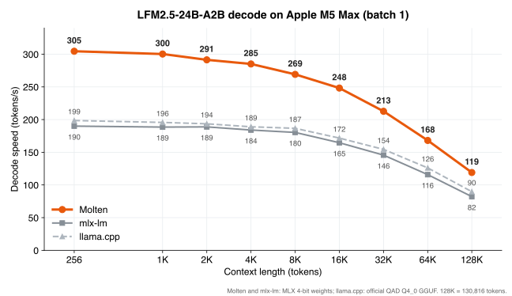
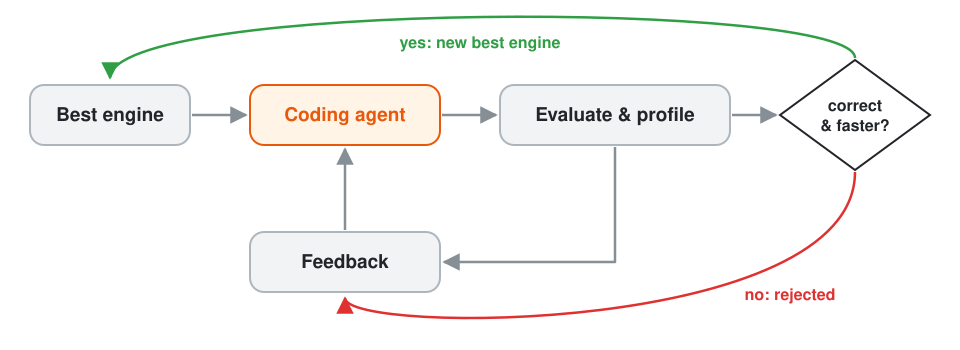
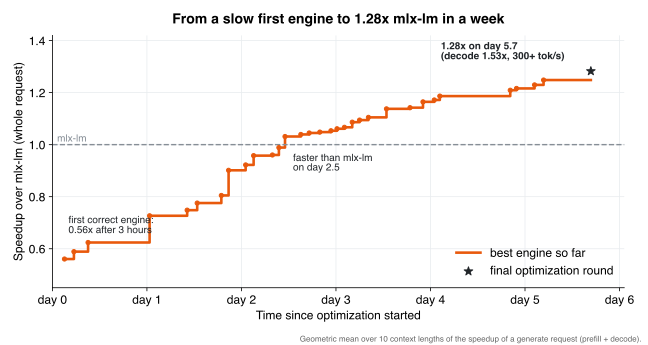
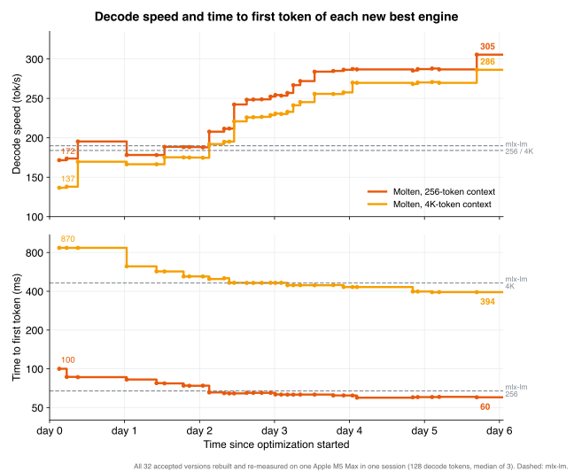

# Molten

**Run a coding model at 300+ tok/s on your Mac.**

Molten is a native **Rust + Metal** inference engine for
**[LiquidAI LFM2.5-24B-A2B](https://huggingface.co/LiquidAI/LFM2.5-24B-A2B)**, a 24B-parameter (2B active) reasoning
and coding-agent model, on Apple Silicon. It runs LiquidAI's official
[MLX 4-bit checkpoint](https://huggingface.co/LiquidAI/LFM2.5-24B-A2B-MLX-4bit) as one small executable.



## Highlights

- **Fast.** 300+ tok/s decode on an M5 Max: 1.45-1.6x mlx-lm and 1.3-1.5x llama.cpp from 256 to 128K tokens of
  context, with a shorter time to first token.
- **One binary, no runtime.** Pure Rust + Metal, about 6 MB. It links only macOS system frameworks: no Python,
  PyTorch or MLX.
- **Ready to use.** A CLI, an interactive chat and an OpenAI-compatible server with streaming, reasoning output and
  tool calls.
- **Faithful.** The same math as mlx-lm, checked token by token. MATH-500 and IFEval scores match LiquidAI's
  published numbers.

## Quick start

Requirements: an **M5-series** Mac (M5, M5 Pro, M5 Max) with 24 GB or more of memory and macOS 26 or newer.

Download the prebuilt binary and the model:

```bash
curl -L https://github.com/zhangshuibai/molten/releases/latest/download/molten-macos-arm64.tar.gz | tar xz
cd molten-macos-arm64
huggingface-cli download LiquidAI/LFM2.5-24B-A2B-MLX-4bit \
  --revision 667408d494bde191c2cb9dd4f4549827816b9275 --local-dir ~/models/lfm2.5
```

```bash
./molten chat  --model ~/models/lfm2.5                          # interactive chat
./molten run   --model ~/models/lfm2.5 --prompt "Write a quicksort in Rust."
./molten serve --model ~/models/lfm2.5 --port 8080              # OpenAI-compatible API
```

If you downloaded the archive with a web browser, clear macOS's download quarantine first:
`xattr -d com.apple.quarantine molten`. To build from source (Rust 1.92 or newer), run `cargo build --release` in a
clone of this repository; the binary is `target/release/molten`.

Any OpenAI client works with the server:

```python
from openai import OpenAI
client = OpenAI(base_url="http://127.0.0.1:8080/v1", api_key="none")
resp = client.chat.completions.create(model="lfm2.5", messages=[{"role": "user", "content": "What is 17 * 23?"}])
print(resp.choices[0].message.content)
```

The model's reasoning comes back in `reasoning_content`, and tool calls come back as OpenAI `tool_calls`. Sampling
defaults to the model card's settings. See [docs/SERVER.md](docs/SERVER.md) for every option.

## Performance

Apple M5 Max (128 GB), one sequence, 128 decode tokens. TPS is decode tokens per second, TTFT the time to the first
token. llama.cpp runs LiquidAI's official Q4_0 GGUF; its TTFT is estimated from llama-bench. 128K is 130,816 tokens.

| context | TPS: Molten / mlx-lm / llama.cpp | TTFT: Molten / mlx-lm / llama.cpp |
|---:|---:|---:|
| 256 | **305** / 190 / 199 | **60 ms** / 67 ms / 70 ms |
| 1K | **300** / 189 / 196 | **128 ms** / 147 ms / 201 ms |
| 2K | **291** / 189 / 194 | **215 ms** / 236 ms / 399 ms |
| 4K | **285** / 184 / 189 | **395 ms** / 464 ms / 859 ms |
| 8K | **269** / 180 / 187 | **791 ms** / 956 ms / 1.82 s |
| 16K | **248** / 165 / 172 | **1.76 s** / 2.17 s / 4.20 s |
| 32K | **213** / 146 / 154 | **3.88 s** / 4.60 s / 9.42 s |
| 64K | **168** / 116 / 126 | **10.5 s** / 12.2 s / 25.2 s |
| 128K | **119** / 82 / 90 | **28.1 s** / 32.4 s / 72.7 s |

End to end, a 1K-token prompt plus 512 generated tokens takes **1.84 s** with Molten, 2.77 s with mlx-lm and 2.81 s
with llama.cpp.

A paired evaluation against mlx-lm, from 256 to 128K tokens of context, gives 1.43-1.53x decode and 1.28x
overall. Methods and all numbers are in [docs/BENCHMARKS.md](docs/BENCHMARKS.md).

## Why it is faster than general-purpose frameworks

Molten serves one model, on one kind of GPU, one sequence at a time. That lets it make choices a general framework
cannot:

- **Model-specific kernel fusion.** Chains of small operators run as single kernels: norm + router + top-4 expert
  selection, expert FFN + weighted combine, Q/K norm + RoPE + attention, LM head + argmax. Each token takes about a
  quarter fewer GPU dispatches.
- **A decode loop that never leaves the GPU.** Generated tokens feed the next step on the GPU. The CPU encodes
  steps ahead and the GPU stays busy 99% of the time.
- **Kernels for fixed shapes.** Every dimension is a compile-time constant, and the quantized matrix-vector kernels
  stream the 4-bit weights close to the memory bandwidth limit.
- **Zero-copy weights.** The official checkpoint is memory-mapped and used in place.
- **Fast prefill.** The prefill kernels use the M5 GPU's matrix units, and query heads that share a KV head share
  its K/V tiles.

Details: [docs/ARCHITECTURE.md](docs/ARCHITECTURE.md).

## How it was built

Molten was written by AI coding agents in a recursive self-improvement loop. The coding agent is **DeepSeek V4.1 Flash
in the Pi agent harness**. It starts each session from the best engine so far, together with the feedback from earlier
rounds. It changes the Rust and Metal code, builds it and checks it. A fixed evaluator then rebuilds the result from
source, checks its tokens against mlx-lm, times both engines at ten context lengths and profiles the candidate while
it runs. The new engine replaces the best one only if it is correct and faster. Either way, the timings, the profile
and the reason for any rejection go back to the agent as feedback for its next session. The RSI framework that runs
this loop will be open-sourced soon.



The whole optimization took **under six days**. The first correct engine ran at 0.56x mlx-lm three hours in.
The engine passed mlx-lm on day 2.5 and reached 1.28x end-to-end (decode 1.53x, 300+ tok/s) on day 5.7.

- 78 agent sessions took the engine from 0.56x to 1.25x. They cost about **$21** of DeepSeek API usage: 1.36 billion
  tokens, 98.6% of them cache hits.
- A final round by Claude, coordinating parallel sub-agents, profiled every kernel and fused the decode path. Each
  change was verified bit for bit. That round took the engine to 1.28x.



Every new best engine, rebuilt and re-measured on the same machine: TPS at 256 tokens of context and TTFT for a
4K-token prompt.



Molten and the RSI framework behind it were created and are led by [Shuibai Zhang](https://zhangshuibai.github.io/).
Collaborators are welcome: if you are interested in this project, feel free to email szhang967@wisc.edu or
shuibai.zhang@outlook.com.

## Accuracy

On two benchmarks from LiquidAI's model card, Molten matches the published scores. The runs used the card's settings
(temperature 0.6, up to 32768 output tokens) on random subsets of 200 problems.

| benchmark | Molten (MLX 4-bit) | LiquidAI (vLLM, BF16) |
|---|---:|---:|
| MATH-500 | 95.5% | 96.04% |
| IFEval (prompt-level, strict) | 96.0% | 96.75% |

Against mlx-lm, greedy tokens agree except at near-ties. The engine also passed teacher-forced agreement checks on
public and held-out prompts from 1 to 131K tokens; see [docs/BENCHMARKS.md](docs/BENCHMARKS.md#correctness).

## Limitations

- **M5-series Macs only**, with macOS 26+ and 24 GB+ of memory. M1-M4 are not supported.
- **One model**: `LiquidAI/LFM2.5-24B-A2B-MLX-4bit` at revision `667408d4`.
- **One sequence at a time**: requests are queued, with no batching. The context limit is 131072 tokens.

## More

- [docs/SERVER.md](docs/SERVER.md): the CLI and server options, reasoning and tool-call handling, prompt-prefix reuse.
- [docs/PROTOCOL.md](docs/PROTOCOL.md): the low-level JSON-lines engine protocol on token ids, with a Python client
  in `scripts/lfm_engine.py`.
- [docs/BENCHMARKS.md](docs/BENCHMARKS.md): methods and full results, with reproduction scripts in `bench/`.

## Citation

If you use Molten in your work, please cite it:

```bibtex
@software{zhang2026molten,
  author  = {Zhang, Shuibai},
  title   = {Molten: A Native Rust + Metal Inference Engine for LFM2.5 on Apple Silicon},
  year    = {2026},
  version = {0.1.0},
  url     = {https://github.com/zhangshuibai/molten}
}
```

## Acknowledgments and license

Inspired by [Lily](https://github.com/perplexityai/pplx-garden/tree/main/lily), Perplexity AI's Rust + Metal engine.
Portions of the Metal runtime and kernels are adapted from Lily (Apache-2.0) and from
[MLX](https://github.com/ml-explore/mlx) and [mlx-lm](https://github.com/ml-explore/mlx-lm) (MIT). See `NOTICE` and
`VENDORED.md` for per-file attribution.

Molten is licensed under Apache-2.0. The model weights are not included: LiquidAI distributes them under the LFM
Open License v1.0.
